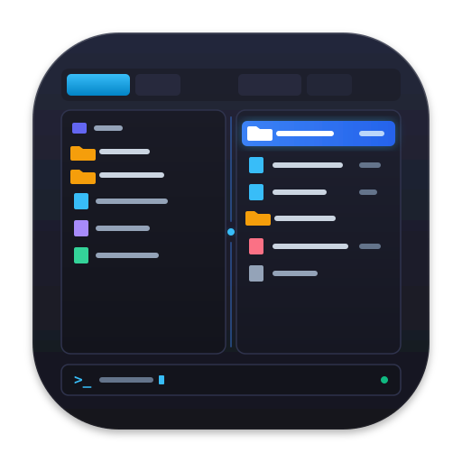

<p align="center">
  
</p>

# Vala Commander (`vcmd`)

A lightweight, responsive, and modern dual-pane file manager for Linux, blending the keyboard-driven speed of Midnight Commander with modern GTK4/Libadwaita GUI aesthetics and Nautilus-grade desktop integration.

Written in **Vala** and compiled directly to a compact native binary via `valac` and GCC with sub-second incremental builds and zero heavy runtime dependencies.

We are all familiar with classic file managers like Midnight Commander (`mc`), Nautilus, Total Commander, Norton Commander, and Volkov Commander, along with many other legendary tools. This project is an attempt to create a lightweight graphical file manager that brings together diverse features from all of them. However, covering every single feature is impossible without a community — any like-minded developers and enthusiasts who would like to support the project and join its development are warmly welcome!

---

## Key Features

### 🗂️ Dual-Pane Navigation & Tabs
* **Dual Independent Panes:** Left and right file panels separated by an adjustable, draggable paned divider (`Gtk.Paned`). Active pane switching via <kbd>Tab</kbd>.
* **Multi-Tab Workspace (`Adw.TabBar` + `Adw.TabView`):**
  * Open new tabs independently in each panel with <kbd>Ctrl</kbd> + <kbd>T</kbd>.
  * Close active tab with <kbd>Ctrl</kbd> + <kbd>W</kbd> (last tab is protected from accidental closing).
  * Cycle tabs with <kbd>Ctrl</kbd> + <kbd>Page Up</kbd> / <kbd>Ctrl</kbd> + <kbd>Page Down</kbd>.
  * **Custom Tab Renaming:** Press <kbd>Ctrl</kbd> + <kbd>Shift</kbd> + <kbd>T</kbd> to rename the active tab (up to 15 characters). Empty input resets back to the folder name.
  * **Persistent Workspace:** Open tabs, custom tab names, active tab index, view modes, window geometry, divider position, and active panel state persist across restarts in standard XDG configuration (`~/.config/vcmd/config`).
  * **Resilient Startup:** If a previously saved path is unavailable or removed (e.g., unmounted drive), the tab is skipped; if all tabs are unavailable, the panel automatically opens the current user's home folder.

### 👁️ Dual View Modes
* **Full View (`Gtk.ColumnView`):** Detailed list with Name, Type, Size, and Date Modified.
  * Resizable columns with column header click-to-sort (ascending and descending).
  * Parent directory `..` is strictly pinned to the top of the file list under any sort order or direction.
* **Brief View (`Gtk.GridView`):** Midnight Commander-style multi-column layout filling the pane height with horizontal columns.
* **Instant View Switch:** Toggle between Full and Brief view with <kbd>Alt</kbd> + <kbd>T</kbd> or the toolbar button.

### ⌨️ Keyboard-First Workflow
* **Universal Layout-Agnostic Shortcuts:** Shortcuts (<kbd>Ctrl</kbd> + <kbd>Q</kbd>, <kbd>Ctrl</kbd> + <kbd>T</kbd>, <kbd>Ctrl</kbd> + <kbd>W</kbd>, <kbd>Ctrl</kbd> + <kbd>Shift</kbd> + <kbd>T</kbd>, <kbd>Alt</kbd> + <kbd>T</kbd>, <kbd>Ctrl</kbd> + <kbd>H</kbd>, <kbd>Ctrl</kbd> + <kbd>L</kbd>, <kbd>Ctrl</kbd> + <kbd>,</kbd>) work seamlessly in any active keyboard layout (Cyrillic, Russian, Latin, etc.) via hardware keycode-to-Latin mapping.
* **Fast Navigation:**
  * <kbd>Backspace</kbd> / <kbd>Alt</kbd> + <kbd>Up</kbd>: Navigate to parent directory up to `/`.
  * <kbd>Enter</kbd> / Double Click: Open folder or launch file using standard FreeDesktop MIME associations.
  * <kbd>Left Arrow</kbd>: In Full view, jumps to the top of the folder (<kbd>Home</kbd> behavior). In Brief view, moves left across columns; at the leftmost column, jumps to the top of the folder.
  * <kbd>Right Arrow</kbd>: In Full view, jumps to the last item in the folder (<kbd>End</kbd> behavior). In Brief view, moves right across columns; at the rightmost column, jumps to the last item.
  * <kbd>Ctrl</kbd> + <kbd>Space</kbd>: Asynchronously calculate folder or file size under the cursor without blocking the UI.
  * <kbd>Ctrl</kbd> + <kbd>S</kbd>: Quick directory filter by substring (case-insensitive, max 20 chars, navigate with <kbd>↑</kbd>/<kbd>↓</kbd>, <kbd>Enter</kbd> to open, <kbd>Escape</kbd> to reset).
  * <kbd>Ctrl</kbd> + <kbd>H</kbd>: Toggle hidden files.
  * <kbd>Ctrl</kbd> + <kbd>L</kbd>: Focus the path entry field for manual path input.

### 💻 Integrated Command Line Bar
* **Midnight Commander-Style Quick CLI:** Simply start typing letters or digits while browsing files to begin entering shell commands in the bottom command bar.
* **Configurable Shell Interpreter:** Select any shell executable in Preferences (<kbd>Ctrl</kbd> + <kbd>,</kbd>) — defaults to `/bin/bash`, with support for `/bin/zsh`, `/usr/bin/fish`, or custom paths. Missing or invalid interpreters trigger a descriptive error dialog.
* **Environment & Config Sourcing:** Commands run as a login/interactive shell (`-l -i -c` for bash/zsh), ensuring user configuration files (`.bashrc`, `.zshrc`, custom aliases, and path variables) are loaded for the user who launched the application.
* **Context-Aware Execution:** Commands run directly inside the active panel's current working directory.
* **Fast `cd` Interception:** Typing `cd <path>` (e.g., `cd /var/log` or `cd ~`) instantly navigates the active panel without launching a subprocess.
* **Command History:** Browse previous commands with <kbd>↑</kbd> and <kbd>↓</kbd> arrow keys.
* Press <kbd>Escape</kbd> to clear command input and return focus to the file list.

### ⚙️ Preferences Window (`Ctrl + ,`)
* Built with native **Libadwaita Preferences** (`Adw.PreferencesWindow`, `Adw.PreferencesPage`, `Adw.SwitchRow`, `Adw.SpinRow`, `Gtk.FontDialogButton`).
* **Path Toolbar Visibility:** Toggle the header path entry and navigation buttons under tabs on/off. When disabled, maximizes vertical screen space for file listings.
* **Brief View Column Width:** Customize the width in pixels for brief view columns (100–800 px) with live preview and keyboard shortcuts (<kbd>Ctrl</kbd> + <kbd>+</kbd> / <kbd>-</kbd>).
* **Custom Typography & Fonts:** Choose custom font families (e.g. Fira Code, JetBrains Mono, Ubuntu Mono) and font sizes (6–36 pt) for file panels with instant live styling.
* Preferences apply immediately and are persisted in `~/.config/vcmd/config`.

---

## Keyboard Shortcuts Reference

| Shortcut | Action |
| :--- | :--- |
| <kbd>Tab</kbd> | Switch active pane (Left ⇄ Right) |
| <kbd>Enter</kbd> | Open directory / launch file with default app |
| <kbd>Backspace</kbd> / <kbd>Alt</kbd> + <kbd>↑</kbd> | Navigate up to parent directory |
| <kbd>Left Arrow</kbd> | Jump to start / top item (<kbd>Home</kbd>) |
| <kbd>Right Arrow</kbd> | Jump to end / last item (<kbd>End</kbd>) |
| <kbd>Ctrl</kbd> + <kbd>Space</kbd> | Calculate directory or file size |
| <kbd>Ctrl</kbd> + <kbd>S</kbd> | Quick directory filter (case-insensitive substring) |
| <kbd>Ctrl</kbd> + <kbd>T</kbd> | Open new tab in active panel |
| <kbd>Ctrl</kbd> + <kbd>Shift</kbd> + <kbd>T</kbd> | Rename active tab (max 15 characters) |
| <kbd>Ctrl</kbd> + <kbd>W</kbd> | Close active tab (protected last tab) |
| <kbd>Ctrl</kbd> + <kbd>Page Up</kbd> / <kbd>Ctrl</kbd> + <kbd>Shift</kbd> + <kbd>Tab</kbd> | Switch to previous tab in active panel |
| <kbd>Ctrl</kbd> + <kbd>Page Down</kbd> / <kbd>Ctrl</kbd> + <kbd>Tab</kbd> | Switch to next tab in active panel |
| <kbd>Alt</kbd> + <kbd>T</kbd> | Toggle Brief / Full view mode |
| <kbd>Ctrl</kbd> + <kbd>+</kbd> / <kbd>-</kbd> | Increase / decrease brief view column width |
| <kbd>Ctrl</kbd> + <kbd>H</kbd> | Toggle hidden files visibility |
| <kbd>Ctrl</kbd> + <kbd>L</kbd> | Focus path entry bar |
| <kbd>Ctrl</kbd> + <kbd>,</kbd> | Open Preferences window |
| <kbd>Ctrl</kbd> + <kbd>Shift</kbd> + <kbd>H</kbd> | Toggle window header bar visibility |
| <kbd>F1</kbd> | Open Keyboard Shortcuts & Help dialog |
| <kbd>Ctrl</kbd> + <kbd>Q</kbd> | Quit application |
| *Type characters* | Start typing shell command in bottom CLI |
| <kbd>↑</kbd> / <kbd>↓</kbd> | Command line history (when typing in CLI) |
| <kbd>Escape</kbd> | Cancel command typing / focus file list |

---

## Build and Run

### Requirements
* `valac` (>= 0.56)
* `libgtk-4-dev` (GTK4)
* `libadwaita-1-dev` (Libadwaita)
* `libglib2.0-dev` (GLib / GIO)
* `make` and `gcc`

### Installing Dependencies

* **Ubuntu / Debian:**
  ```bash
  sudo apt update && sudo apt install -y git make gcc valac libgtk-4-dev libadwaita-1-dev libglib2.0-dev
  ```

* **Fedora:**
  ```bash
  sudo dnf install -y git make gcc vala gtk4-devel libadwaita-devel glib2-devel
  ```

* **Arch Linux:**
  ```bash
  sudo pacman -S --needed git make gcc vala gtk4 libadwaita glib2
  ```

* **ALT Linux (p10 / p11):**
  ```bash
  sudo apt-get update && sudo apt-get install -y git make gcc vala libgtk4-devel libadwaita-devel libgio-devel
  ```

### Compilation
Compile directly using the Makefile (sub-second build time):
```bash
make
```

### Launch
```bash
make run
# or directly:
./vcmd
```
