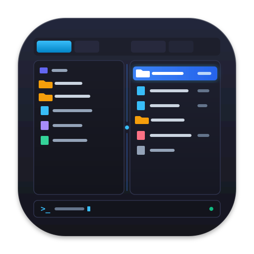

<p align="center">
  
</p>

# Vala Commander (`vcmd`)

A lightweight, responsive, and modern dual-pane file manager for Linux, blending the keyboard-driven speed of Midnight Commander with modern GTK4/Libadwaita GUI aesthetics and Nautilus-grade desktop integration.

Written in **Vala** and compiled directly to a compact native binary via `valac` and GCC with sub-second incremental builds and zero heavy runtime dependencies.

We are all familiar with classic file managers like Midnight Commander (`mc`), Nautilus, Total Commander, Norton Commander, and Volkov Commander, along with many other legendary tools. This project brings together the best features from all of them: instant keyboard navigation, a true embedded terminal drawer, robust dual-pane file operations, and a modern GNOME HIG design.

---

## Key Features

### 🗂️ Dual-Pane Navigation & Tabs
* **Dual Independent Panes:** Left and right file panels separated by an adjustable, draggable paned divider (`Gtk.Paned`). Active pane switching via <kbd>Tab</kbd>.
* **Multi-Tab Workspace (`Adw.TabBar` + `Adw.TabView`):**
  * Open new tabs independently in each panel with <kbd>Ctrl</kbd> + <kbd>T</kbd>.
  * Close active tab with <kbd>Ctrl</kbd> + <kbd>W</kbd> (last tab is protected from accidental closing).
  * Cycle tabs with <kbd>Ctrl</kbd> + <kbd>Page Up</kbd> / <kbd>Ctrl</kbd> + <kbd>Page Down</kbd> or <kbd>Ctrl</kbd> + <kbd>Tab</kbd> / <kbd>Ctrl</kbd> + <kbd>Shift</kbd> + <kbd>Tab</kbd>.
  * **Custom Tab Renaming:** Press <kbd>Ctrl</kbd> + <kbd>Shift</kbd> + <kbd>T</kbd> to rename the active tab (up to 15 characters). Empty input resets back to the folder name.
  * **Persistent Workspace:** Open tabs, custom tab names, active tab index, view modes, window geometry, divider position, and active panel state persist across restarts in standard XDG configuration (`~/.config/vcmd/config`).
  * **Resilient Startup:** If a previously saved path is unavailable or removed (e.g., unmounted drive), the tab is skipped; if all tabs are unavailable, the panel automatically opens the current user's home folder.
  * **Panel Synchronization:** Press <kbd>Alt</kbd> + <kbd>I</kbd> or <kbd>Esc</kbd> > <kbd>i</kbd> to immediately synchronize the opposite panel to the active panel's directory.

### 👁️ Triple View Modes (<kbd>Alt</kbd> + <kbd>T</kbd>)
* **Full / Detailed View (`Gtk.ColumnView`):** Detailed list with Name, Type, Size, and Date Modified.
  * Resizable columns with column header click-to-sort (ascending and descending).
  * Parent directory `..` is strictly pinned to the top of the file list under any sort order or direction.
* **Brief View (`Gtk.GridView`):** Midnight Commander-style multi-column layout filling the pane height with horizontal columns. Configurable column width (100–800 px) with live adjustments (<kbd>Ctrl</kbd> + <kbd>+</kbd> / <kbd>-</kbd>).
* **Super Detailed View:** Single-pane maximized view with deep metadata display and enhanced layout, ideal for focused inspecting or working on smaller displays.

### 🏷️ Multi-Selection & Item Tagging
* **Item Tagging:** Press <kbd>Insert</kbd> or <kbd>KP_Insert</kbd> to toggle tag on the current file or folder and automatically advance the cursor down.
* **Select by Mask:** Press <kbd>+</kbd> on Keypad or <kbd>Shift</kbd> + <kbd>+</kbd> in number row to select files matching a wildcard mask (e.g., `*.png`, `*test*`).
* **Clear Selection:** Double-tap <kbd>Escape</kbd> to unselect/untag all items in the active panel.
* **Selection-Aware Operations:** File operations (Copy, Move, Delete) automatically operate on all tagged items or the single focused item if none are tagged.

### 💻 Embedded Interactive VTE Terminal Drawer (<kbd>Ctrl</kbd> + <kbd>O</kbd> / <kbd>Ctrl</kbd> + <kbd>~</kbd>)
* **True PTY Terminal:** Embedded GTK4 `Vte.Terminal` drawer running directly below the file panels.
* **Full TUI Support:** Run interactive console applications (`top`, `htop`, `mc`, `nano`, `vim`, `less`) natively with full 256-color / truecolor support and standard terminal keystroke processing.
* **Full Shell Environment:** Automatically spawns an interactive shell session (`bash -i`) sourcing `~/.bashrc`, user functions, environment variables, and custom aliases (e.g., `ll`, `l`, `docker-*`).
* **Focus Locking:** When the terminal drawer is open, the single-line command bar is hidden, and keyboard focus is locked into the terminal until explicitly closed (<kbd>Ctrl</kbd> + <kbd>O</kbd>, <kbd>Ctrl</kbd> + <kbd>~</kbd>, typing `exit`, or the header close button).
* **Directory Synchronization:** Automatically spawns in the active panel's directory and syncs paths when reopening. Includes a manual **Sync Directory** header button (`folder-symbolic`).
* **Audible Bell Silencing:** Terminal audible bells and system error bells are fully silenced application-wide.

### 📋 Integrated Command Line & Function Bar
* **Quick Command Entry:** When the terminal drawer is closed, simply start typing to enter commands in the bottom command bar. Pressing <kbd>Enter</kbd> opens the terminal drawer and executes the command directly in the PTY terminal.
* **Built-in `cd` Navigation:** Typing `cd <path>` navigates the active panel immediately without opening a shell.
* **Command History:** Browse previous commands with <kbd>↑</kbd> and <kbd>↓</kbd>.
* **Insert File Name:** Press <kbd>Ctrl</kbd> + <kbd>Enter</kbd> to insert the focused file/folder name (properly shell-escaped) into the command entry.
* **Function Key Bar (F1..F10):** Midnight Commander-style bottom bar (<kbd>F1</kbd> Help, <kbd>F3</kbd> View, <kbd>F4</kbd> Edit, <kbd>F5</kbd> Copy, <kbd>F6</kbd> Move, <kbd>F7</kbd> Mkdir, <kbd>F8</kbd> Delete, <kbd>F10</kbd> Quit). Can be toggled on/off in Preferences.

### 📁 Robust Asynchronous File Operations
* **Non-blocking Execution:** All copying, moving, deletion, and directory scanning run asynchronously via GIO APIs (`GFile.copy_async`, `GFile.move_async`, `GFileEnumerator`).
* **Progress Dialog:** Informative dialog displaying operation progress, item counts, and status.
* **Unified Conflict Resolution:** Centralized handling for overwrite, skip, or retry when encountering existing files or permissions issues.
* **Trash & Direct Delete:** Support for both FreeDesktop Trash and direct permanent deletion.

### 📦 Archive Virtual File System & Packing (<kbd>Shift</kbd> + <kbd>F2</kbd>)
* **Virtual Archive VFS (`archive:///`):** Press <kbd>Enter</kbd> or double-click any archive or container file (`.zip`, `.tar.*`, `.7z`, `.rar`, `.deb`, `.rpm`, `.iso`, etc.) to enter and navigate it as a virtual directory.
* **Instant Navigation & In-Archive Viewing:** Fast in-memory tree browsing with accurate dates, sizes, permissions, and directory hierarchies. Press <kbd>Enter</kbd>, <kbd>F3</kbd>, or <kbd>F4</kbd> to inspect or edit files directly from within the archive.
* **Password & Encryption Support:** Seamless password prompting dialog (`Adw.AlertDialog`) with session caching and peek toggle for password-protected `.zip` and `.7z` archives.
* **Archive Pack Dialog (<kbd>Shift</kbd> + <kbd>F2</kbd>):** Pack selected files into `.zip`, `.tar.gz`, `.7z`, `.tar.xz`, `.tar.zst`, `.tar.bz2`, or `.tar` with configurable compression levels (Store, Fast, Normal, Maximum, Ultra), optional password encryption, and "Delete files after archiving" (move to archive).

### 🌐 Remote Connections (<kbd>F2</kbd>)
* Connect to SSH, SFTP, FTP, or SMB through GVfs. SSH and SFTP first try the SSH agent from the built-in terminal (`SSH_AUTH_SOCK`) via `sshfs`. If that key is not available, the system asks for a password.
* The address can be saved as a bookmark without the password. Opening that bookmark mounts the location again.
* Copy, move, delete, and navigation use the same file operations as local folders.

### 🔖 Directory Bookmarks / Hotlist (<kbd>Ctrl</kbd> + <kbd>\</kbd>)
* Fast access to frequently visited directories and virtual GVfs URIs.
* Add current directory with custom title, remove bookmarks, and jump instantly with <kbd>Enter</kbd>.
* Built using modern `Adw.Dialog` components with customizable dialog dimensions.

### 🔎 File Search (<kbd>Alt</kbd> + <kbd>F7</kbd>)
* Search the active tab's directory, or any chosen start folder, without blocking the interface.
* Match file and folder names by mask (`*` and `?`). A word without wildcards matches anywhere in the name.
* Optionally search text inside files. Directories are matched by name only.
* Case sensitivity and hidden files can be toggled. The name, content, and those toggles are restored the next time the dialog opens. The start path always comes from the active tab.
* Matches open in a new **Search** tab in Super Detailed view, with the relative path in the name column and the cursor on the first match.
* <kbd>Backspace</kbd>, <kbd>Alt</kbd> + <kbd>↑</kbd>, or `..` leaves the results and opens the folder that was searched. Viewing or editing a match keeps the results tab.

### 🚀 "Open With..." Dialog (<kbd>Ctrl</kbd> + <kbd>Shift</kbd> + <kbd>O</kbd>)
* Search and launch any registered desktop application for the selected file with instant filtering.

### ⚙️ Preferences Window (<kbd>Ctrl</kbd> + <kbd>,</kbd>)
* Built with native **Libadwaita Preferences** (`Adw.PreferencesWindow`).
* **Appearance & Typography:** Choose font family, size, weight, and style for file lists and the built-in terminal. Bold and italic faces from the font dialog are applied live.
* **Layout & Visibility:** Toggle path toolbar, function key bar, and customize brief view column width.
* **Dialog Sizes:** Customize default width and height for dialogs (Bookmarks, Shortcuts, Open With).
* **Shell & Console:** Configure preferred shell interpreter (`/bin/bash`, `/bin/zsh`, `/usr/bin/fish`) and terminal scrollback history limit.

---

## 🔌 ExtFS Plugins & Custom Archive Handlers

`vcmd` features full compatibility with the **Midnight Commander ExtFS (External Virtual File System)** plugin specification. This allows browsing and extracting archive and container formats without writing custom code or linking external libraries.

### Supported Out of the Box
* **System ExtFS Helpers:** If Midnight Commander is installed or system ExtFS helpers are present (`/usr/lib/mc/extfs.d/`, `/usr/libexec/mc/extfs.d/`), `vcmd` automatically recognizes and browses `.deb`, `.rpm`, `.iso`, `.rar`, `.cab`, `.arj`, `.lha`, `.zoo`, `.wim`, `.cpio`, `.a`, and more.
* **Native Fallbacks:** Standard formats (`.zip`, `.tar.*`, `.7z`) use fast direct CLI tools (`tar`, `unzip`, `7z`).

### Creating Custom Plugins
Users can easily add support for proprietary or exotic container formats by dropping an executable shell or Python script into:
```bash
~/.config/vcmd/extfs/
```

#### Auto-Binding Convention
If your script is named `foo` (and marked executable with `chmod +x ~/.config/vcmd/extfs/foo`), `vcmd` will automatically match and open all `*.foo` files with it!

#### ExtFS Protocol Specification
ExtFS plugins are executable scripts that receive commands as command-line arguments:

1. **`list <archive_file>`** (Required)
   Outputs the archive's table of contents to `stdout` in standard `ls -l` format:
   ```text
   PERMS LINKS OWNER GROUP SIZE DATE TIME [PATH/]FILENAME [-> [PATH/]FILENAME]
   ```
   *Example output:*
   ```text
   drwxr-xr-x 1 user group 0 Nov 04 12:00 docs/
   -rw-r--r-- 1 user group 1024 Nov 04 12:00 docs/manual.txt
   ```
   *Note:* The output must not include `.` or `..` entries.

2. **`copyout <archive_file> <member_path> <dest_file>`** (Required for viewing/extraction)
   Extracts `member_path` from `archive_file` into `dest_file`.

3. **`copyin <archive_file> <member_path> <source_file>`** (Optional, for writable formats)
   Injects `source_file` as `member_path` inside `archive_file`.

4. **`rm <archive_file> <member_path>`** (Optional)
   Removes `member_path` from `archive_file`.

5. **`mkdir <archive_file> <dir_path>`** (Optional)
   Creates `dir_path` inside `archive_file`.

#### Example Skeleton Script (`~/.config/vcmd/extfs/mycontainer`):
```bash
#!/bin/bash
ACTION="$1"
ARCHIVE="$2"

case "$ACTION" in
    list)
        # Output table of contents formatted like ls -l
        mytool list "$ARCHIVE" | awk '{ printf "-rw-r--r-- 1 user group %s Nov 04 12:00 %s\n", $1, $2 }'
        exit 0
        ;;
    copyout)
        MEMBER="$3"
        DEST="$4"
        mytool extract-file "$ARCHIVE" "$MEMBER" -o "$DEST"
        exit $?
        ;;
    copyin)
        MEMBER="$3"
        SRC="$4"
        mytool add-file "$ARCHIVE" "$MEMBER" "$SRC"
        exit $?
        ;;
    rm)
        MEMBER="$3"
        mytool remove-file "$ARCHIVE" "$MEMBER"
        exit $?
        ;;
    *)
        exit 1
        ;;
esac
```
Mark it executable:
```bash
chmod +x ~/.config/vcmd/extfs/mycontainer
```

#### Custom Extension Mappings (`~/.config/vcmd/extfs.ini`)
To map multiple extensions or regular expressions to an ExtFS helper, you can create `~/.config/vcmd/extfs.ini` (or use existing `~/.config/mc/mc.ext.ini`):
```ini
[mycontainer]
Shell=.mycontainer
Regex=\.(cnt|pak|bundle)$
Open=%cd %p/mycontainer://
```

---

## Keyboard Shortcuts Reference

| Shortcut | Action |
| :--- | :--- |
| <kbd>Tab</kbd> | Switch active pane (Left ⇄ Right) |
| <kbd>Enter</kbd> | Open directory / launch file with default app |
| <kbd>Backspace</kbd> / <kbd>Alt</kbd> + <kbd>↑</kbd> | Navigate up to parent directory; leave search results |
| <kbd>Left Arrow</kbd> | Jump to start / top item (<kbd>Home</kbd>) |
| <kbd>Right Arrow</kbd> | Jump to end / last item (<kbd>End</kbd>) |
| <kbd>Ctrl</kbd> + <kbd>Space</kbd> | Calculate directory or file size |
| <kbd>Ctrl</kbd> + <kbd>S</kbd> | Quick directory filter (case-insensitive substring) |
| <kbd>Insert</kbd> / <kbd>KP_Insert</kbd> | Toggle tag on current item and advance cursor |
| <kbd>+</kbd> / <kbd>KP_Add</kbd> | Select files by wildcard mask (e.g. `*.txt`) |
| <kbd>Double Escape</kbd> | Clear all tagged/selected items |
| <kbd>Alt</kbd> + <kbd>I</kbd> or <kbd>Esc</kbd> > <kbd>i</kbd> | Sync opposite panel to active directory |
| <kbd>Ctrl</kbd> + <kbd>O</kbd> / <kbd>Ctrl</kbd> + <kbd>~</kbd> | Toggle Interactive Terminal Drawer |
| <kbd>Ctrl</kbd> + <kbd>\</kbd> | Directory Bookmarks / Hotlist |
| <kbd>Ctrl</kbd> + <kbd>Shift</kbd> + <kbd>O</kbd> | Open selected file with... (`OpenWithDialog`) |
| <kbd>Ctrl</kbd> + <kbd>T</kbd> | Open new tab in active panel |
| <kbd>Ctrl</kbd> + <kbd>Shift</kbd> + <kbd>T</kbd> | Rename active tab (max 15 characters) |
| <kbd>Ctrl</kbd> + <kbd>W</kbd> | Close active tab (protected last tab) |
| <kbd>Ctrl</kbd> + <kbd>Page Up</kbd> / <kbd>Ctrl</kbd> + <kbd>Shift</kbd> + <kbd>Tab</kbd> | Switch to previous tab in active panel |
| <kbd>Ctrl</kbd> + <kbd>Page Down</kbd> / <kbd>Ctrl</kbd> + <kbd>Tab</kbd> | Switch to next tab in active panel |
| <kbd>Alt</kbd> + <kbd>T</kbd> | Cycle view mode (Brief ⇄ Detailed ⇄ Super Detailed) |
| <kbd>Ctrl</kbd> + <kbd>+</kbd> / <kbd>-</kbd> | Increase / decrease brief view column width |
| <kbd>Ctrl</kbd> + <kbd>H</kbd> | Toggle hidden files visibility |
| <kbd>Ctrl</kbd> + <kbd>L</kbd> | Focus path entry bar |
| <kbd>Ctrl</kbd> + <kbd>,</kbd> | Open Preferences window |
| <kbd>Ctrl</kbd> + <kbd>Shift</kbd> + <kbd>H</kbd> | Toggle window header bar visibility |
| <kbd>Ctrl</kbd> + <kbd>Enter</kbd> | Insert selected item name into bottom command line |
| <kbd>F1</kbd> | Open Keyboard Shortcuts & Help dialog |
| <kbd>F2</kbd> | Connect to a remote server (SSH, SFTP, FTP, SMB) |
| <kbd>Shift</kbd> + <kbd>F2</kbd> | Pack selected files to archive (`ArchivePackDialog`) |
| <kbd>F3</kbd> | View selected file in external viewer |
| <kbd>F4</kbd> | Edit selected file in external editor |
| <kbd>F5</kbd> | Copy selected / tagged items |
| <kbd>F6</kbd> | Move / rename selected / tagged items |
| <kbd>F7</kbd> | Create new directory |
| <kbd>Alt</kbd> + <kbd>F7</kbd> | Search files by name and content |
| <kbd>F8</kbd> | Delete selected / tagged items |
| <kbd>F10</kbd> / <kbd>Ctrl</kbd> + <kbd>Q</kbd> | Quit application |
| *Type characters* | Start typing shell command in bottom CLI |
| <kbd>↑</kbd> / <kbd>↓</kbd> | Command line history |
| <kbd>Escape</kbd> | Cancel command typing / focus file list |

---

## Build and Run

### Requirements
* `valac` (>= 0.56)
* `libgtk-4-dev` (GTK4)
* `libadwaita-1-dev` (Libadwaita)
* `libvte-2.91-gtk4` (VTE terminal widget for GTK4)
* `libglib2.0-dev` (GLib / GIO)
* `make` and `gcc`
* **GNU Binutils (`as`)**:
  * If building with **GCC 15+**, `binutils` >= **2.43** is required (GCC 15 emits `.base64` assembler directives for UTF-8 string literals, which requires GNU Assembler 2.43 or newer).

### Installing Dependencies

* **Ubuntu / Debian:**
  ```bash
  sudo apt update && sudo apt install -y git make gcc valac libgtk-4-dev libadwaita-1-dev libvte-2.91-gtk4-dev libglib2.0-dev
  ```

* **Fedora:**
  ```bash
  sudo dnf install -y git make gcc vala gtk4-devel libadwaita-devel vte291-gtk4-devel glib2-devel
  ```

* **Arch Linux:**
  ```bash
  sudo pacman -S --needed git make gcc vala gtk4 libadwaita vte4 glib2
  ```

* **ALT Linux (p10 / p11 / Sisyphus):**
  ```bash
  sudo apt-get update && sudo apt-get install -y git make gcc binutils vala libgtk4-devel libadwaita-devel libvte3-devel libgio-devel
  ```

### Compilation
Compile directly using the Makefile (sub-second build time):
```bash
make
```

### Run & Install
```bash
# Test run directly
make run

# Install locally to ~/.local/bin/vcmd and register desktop entry
make install-lite
# or:
./install.sh lite
```
